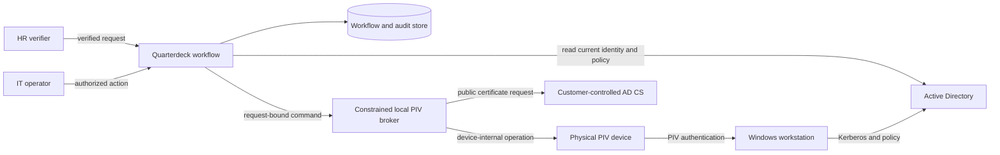
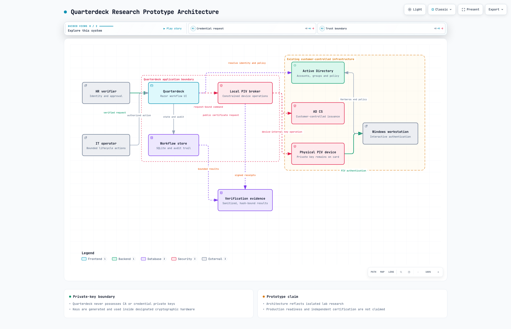

# Quarterdeck Engineering Case Study

> Start here for the short version. Deeper engineering notes, diagrams, evidence
> boundaries and lessons learned are linked below.

Quarterdeck is a multi-version research project exploring how a small Windows
environment could coordinate the lifecycle of physical PIV credentials without
turning the workflow application into a certificate authority or a custodian of
private keys.

## About these public notes

This repository is a cleaned public edition of notes from Glenn Byron's
personal Quarterdeck research and development. The private R&D repositories
remain the detailed sources of truth. AI tools helped organize, rewrite,
sanitize and check the material for public release; Glenn selected the content,
set the claim boundaries and approved the result. This is an AI-assisted
publication process—not independent validation and not a claim that AI created
or owns the underlying work.

The work combines systems engineering, Windows identity, PKI, secure workflow
design, recovery engineering, DevSecOps and human-centered operations. It was
built and tested in an isolated, owner-operated lab. It is **not a production
product, federal authorization, compliance certification or claim of universal
PIV interoperability**.

## The problem

Issuing a strong physical credential is not one action. Someone must establish
the person's identity, authorize the request, prepare an existing account,
generate a key on the intended physical device, request a certificate from an
authorized CA, prove the credential works, deliver it to the right person and
retain enough evidence to explain what happened.

Quarterdeck explores how to make that process visible, recoverable and
auditable while preserving the authority of existing Windows infrastructure.

```text
HR request and identity verification
                ↓
IT account preparation and exact-subject review
                ↓
Approved physical PIV device and device-internal key generation
                ↓
Customer-controlled certificate issuance
                ↓
Windows authentication proof, delivery and retained evidence
```

## What the prototypes demonstrated

| Stage | Engineering purpose | Honest disposition |
| --- | --- | --- |
| CAC-program | Explore Windows smart-card authentication and the supporting PKI/network concepts | Public historical foundation |
| V1 | Implement the initial workflow, authorization and product concept | Complete and frozen reference |
| V2 | Exercise AD, AD CS, physical PIV, Windows logon, revocation, recovery, teardown and recast in the lab | Complete author-produced lab milestone |
| V3 | Reuse V2 while correcting workflow ambiguity, recovery, identity binding, commissioning and evidence boundaries | Preserved but incomplete |
| V4 | Test a smaller administrator-tool direction and a constrained AI installation model | Bounded concept; paused after finding a stale-session authorization weakness |

The progression matters more than any single prototype: each version records
what was retained, what failed and why the next design changed.

## Core architecture

Quarterdeck coordinates existing authority; it does not replace it.



[Open the interactive architecture diagram](diagrams/quarterdeck-architecture.html).



## Security boundaries

- Quarterdeck contains no CA signing implementation.
- CA and credential private keys never enter Quarterdeck.
- Credential keys are generated and used inside the designated physical PIV
  device; CA keys remain under the authority of the CA platform and its
  configured cryptographic boundary.
- Operators do not gain server, database or CA-administrator access merely by
  using the application.
- Unknown identity, stale authorization, failed audit persistence or ambiguous
  external outcomes fail closed.
- Approval, issuance, verification, delivery and receipt are separate facts.
- The system records uncertainty instead of blindly retrying an operation that
  might already have succeeded.

## Selected engineering results

- A physical YubiKey PIV credential was used in the isolated lab to complete a
  Windows domain smart-card authentication path through native Windows
  interfaces.
- Revoked-certificate, disabled-account and trust/publication failure paths were
  exercised during the V2 lab campaign.
- Backup, restore, disposable-CA teardown and recast procedures were tested in
  the owner-operated environment.
- V3 introduced stronger exact-request binding, durable operation intent,
  explicit ambiguous outcomes and recovery against an independent simulated
  authority journal.
- Protected Windows qualification was used repeatedly for warning-as-error
  builds, locked dependency restoration, regression tests and fail-closed
  installer checks.
- A bounded V4 experiment found that an already-open JEA session could retain
  stale authority after a directory-role change. The design was stopped rather
  than weakening the requirement; future work would require per-request
  authorization based on the actual Windows client token.

All of these are **author-produced lab results**. Exact private evidence remains
in the private R&D repositories.

## Engineering approach

- Requirements and explicit acceptance gates before live effects.
- Signed Git history and hash-bound evidence packages.
- Reuse-first versioning: V3 did not repeat unchanged V2 campaigns.
- Separate simulation, live-lab and production claims.
- Negative and fault-injection tests alongside happy paths.
- Backups and recovery points before high-risk experiments.
- AI used as an engineering assistant and bounded executor—not as the authority
  that grades its own work.

## Read next

- [Problem, users and scope](docs/01-problem-and-scope.md)
- [Evolution from CAC-program through V4](docs/02-engineering-evolution.md)
- [Security and trust boundaries](docs/03-security-boundaries.md)
- [Verification and evidence model](docs/04-verification-and-evidence.md)
- [Failures and design lessons](docs/05-failures-and-lessons.md)
- [Limitations and non-claims](docs/06-limitations-and-nonclaims.md)
- [How AI was used](docs/07-ai-assisted-engineering.md)
- [Demonstration and interview walkthrough](docs/08-demonstration-plan.md)
- [Public-source review record](docs/PUBLICATION-REVIEW.md)

## Related public work

- [CAC-program](https://github.com/glennbyron1/CAC-program) — the earlier
  smart-card and Windows-authentication research that helped start this work.

## Author

Glenn Byron designed the system boundaries, lab environment, requirements,
experiments, acceptance decisions and iteration strategy. These public notes
were copied selectively from that personal R&D and cleaned with AI assistance.
AI tools also assisted during the research with organization, documentation,
code generation, review, troubleshooting and test development under Glenn's
direction. Results were accepted only when supported by source, observed
execution or preserved evidence; AI output was not treated as independent
assurance.

## Repository status and rights

This repository is a portfolio case study, not distributable Quarterdeck
software. No private implementation source, credentials, operational secrets or
customer data are included. Unless a file states otherwise, all rights are
reserved.
